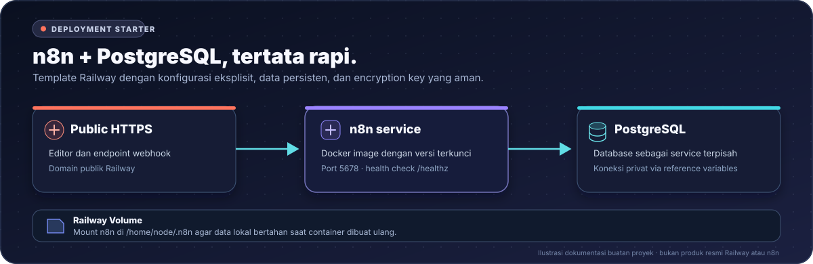
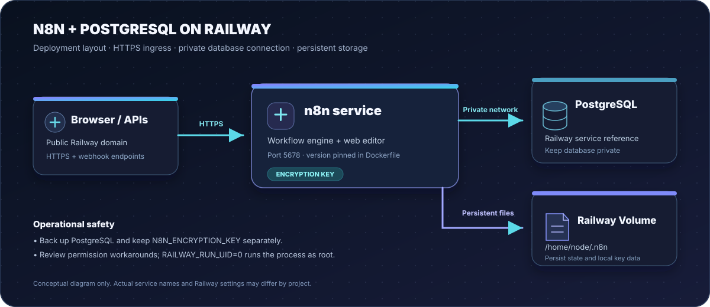

<div align="center">


# n8n Railway Starter

<p>
  <a href="https://github.com/DURIAN-ORGANISASI/n8n-railway/actions/workflows/validate.yml"></a>
  <a href="LICENSE"></a>
  
  
  
</p>

<p><a href="README.md">🇮🇩 Bahasa Indonesia</a> · <a href="README.en.md">🇬🇧 English</a></p>

<p><strong>Deploy n8n + PostgreSQL di Railway.</strong><br>
Penyimpanan persisten, variabel contoh, dan kunci enkripsi yang dibuat secara kriptografis.</p>

<p>
  <a href="#fitur-utama">Fitur utama</a> ·
  <a href="#arsitektur">Arsitektur</a> ·
  <a href="#isi-repositori">Isi repositori</a> ·
  <a href="#instalasi-railway">Instalasi Railway</a> ·
  <a href="#keamanan-dan-backup">Keamanan &amp; backup</a> ·
  <a href="#troubleshooting">Troubleshooting</a> ·
  <a href="#sumber-atribusi-dan-lisensi">Sumber &amp; lisensi</a>
</p>

</div>



<p align="center"><sub>Ilustrasi dokumentasi buatan proyek — bukan tangkapan layar atau aset resmi n8n maupun Railway.</sub></p>

---

## Ringkasan

Starter ini menyiapkan **n8n dan PostgreSQL sebagai dua service terpisah di satu project/environment Railway**. Versi n8n dipatok di Dockerfile agar upgrade tidak terjadi diam-diam. Data n8n membutuhkan Railway Volume.

> [!IMPORTANT]
> **MIT di repo ini bukan lisensi untuk software n8n.** MIT mencakup materi proyek yang tercakup dalam lisensi tersebut; n8n Community Edition memiliki lisensi upstream sendiri. Baca [Sumber, atribusi, dan lisensi](#sumber-atribusi-dan-lisensi) sebelum memakai atau mendistribusikan ulang.

## Fitur utama

| Kapabilitas | Yang disediakan |
| --- | --- |
| Deploy terkontrol | **Dockerfile** mengunci versi n8n agar upgrade tidak terjadi tanpa sengaja. |
| Database terpisah | PostgreSQL terhubung memakai reference variables Railway, bukan kredensial yang ditempel ke dokumentasi. |
| Penyimpanan persisten | Railway Volume untuk state lokal n8n; PostgreSQL menyimpan data aplikasi. |
| Pengaturan keamanan | Skrip pembuat encryption key, contoh variabel, dan catatan risiko permission yang eksplisit. |
| Pengembangan lokal | Docker Compose serta pemeriksaan statis untuk konfigurasi, tautan dokumentasi, dan SVG. |

## Arsitektur



<sub>Diagram konseptual buatan proyek, bukan screenshot resmi n8n atau Railway.</sub>

## Isi repositori

| Path | Peran |
| --- | --- |
| **Dockerfile** dan **railway.json** | Build image, konfigurasi deploy, dan health check Railway. |
| **n8n-service-variables.example.txt** | Template variables khusus service n8n dengan placeholder untuk secret dan referensi PostgreSQL. |
| **.env.example** dan **docker-compose.local.yml** | Menjalankan stack lokal tanpa memasukkan secret ke Git. |
| **scripts/** | Membuat encryption key, memvalidasi konfigurasi, memeriksa dokumentasi, dan memperbarui manifest file. |
| **docs/SOURCES.md** | Referensi teknis upstream, atribusi diagram, batas lisensi, dan catatan merek dagang. |
| **CONTRIBUTING.md** dan **SECURITY.md** | Alur kontribusi dan pelaporan/penanganan isu keamanan. |
| **FILE-MANIFEST.json** | Ukuran file dan SHA-256 untuk membantu mendeteksi perubahan yang belum tercatat. |

## Instalasi Railway

### 1. **Buat project dan PostgreSQL.**

Di [Railway](https://railway.com/), buat project lalu pilih **New → Database → PostgreSQL**. Tunggu hingga database sehat. Gunakan nama service `Postgres` serta tempatkan database dan n8n di project/environment yang sama. Railway membuat variabel database otomatis; **jangan membuat atau menempelkan variabel database secara manual**.

Jika nama service berbeda, sesuaikan awalan `Postgres` pada reference variables.

### 2. Siapkan repo GitHub.

Fork repo ini atau unggah isinya ke GitHub. Pastikan `Dockerfile` dan `railway.json` berada di root repo.

### 3. **Deploy n8n.**

Di project Railway yang sama, pilih **New → GitHub Repo**, lalu pilih repo ini. Biarkan **Root Directory** kosong agar Railway menemukan konfigurasi build.

### 4. Buat domain dan volume.

Di service n8n:

- Buka **Settings → Networking → Generate Domain**. Jika diminta target port, isi `5678`.
- Tambahkan **Volume** dengan mount path `/home/node/.n8n`.
- Referensi `N8N_HOST`, `N8N_EDITOR_BASE_URL`, dan `WEBHOOK_URL` akan memakai `RAILWAY_PUBLIC_DOMAIN`.

### 5. Buat encryption key dan pasang variabel.

Jalankan salah satu skrip dari root repo:

- Windows PowerShell: `.\scripts\generate-key.ps1`
- Linux/macOS: `sh scripts/generate-key.sh`

Skrip menghasilkan 32 byte acak dalam format hexadecimal. Simpan hasilnya sebagai rahasia.

Salin blok ini ke **n8n service → Variables → Raw Editor**. Ganti `REPLACE_WITH_YOUR_64_CHARACTER_HEX_KEY` dengan key yang dihasilkan. **Blok ini hanya untuk service n8n, bukan PostgreSQL.**

```dotenv
N8N_PORT=5678
N8N_PROTOCOL=https
N8N_HOST=${{RAILWAY_PUBLIC_DOMAIN}}
N8N_EDITOR_BASE_URL=https://${{RAILWAY_PUBLIC_DOMAIN}}
WEBHOOK_URL=https://${{RAILWAY_PUBLIC_DOMAIN}}
N8N_PROXY_HOPS=1
N8N_SECURE_COOKIE=true
N8N_ENCRYPTION_KEY=REPLACE_WITH_YOUR_64_CHARACTER_HEX_KEY
N8N_ENFORCE_SETTINGS_FILE_PERMISSIONS=true
RAILWAY_RUN_UID=0
DB_TYPE=postgresdb
DB_POSTGRESDB_HOST=${{Postgres.PGHOST}}
DB_POSTGRESDB_PORT=${{Postgres.PGPORT}}
DB_POSTGRESDB_DATABASE=${{Postgres.PGDATABASE}}
DB_POSTGRESDB_USER=${{Postgres.PGUSER}}
DB_POSTGRESDB_PASSWORD=${{Postgres.PGPASSWORD}}
GENERIC_TIMEZONE=Asia/Jakarta
TZ=Asia/Jakarta
N8N_DIAGNOSTICS_ENABLED=false
N8N_PERSONALIZATION_ENABLED=false
N8N_VERSION_NOTIFICATIONS_ENABLED=false
EXECUTIONS_DATA_PRUNE=true
EXECUTIONS_DATA_MAX_AGE=168
```

Untuk database, pilih **reference variables Railway** berikut, bukan kredensial yang ditempel secara manual:

| Variable n8n | Reference value |
| --- | --- |
| `DB_POSTGRESDB_HOST` | `${{Postgres.PGHOST}}` |
| `DB_POSTGRESDB_PORT` | `${{Postgres.PGPORT}}` |
| `DB_POSTGRESDB_DATABASE` | `${{Postgres.PGDATABASE}}` |
| `DB_POSTGRESDB_USER` | `${{Postgres.PGUSER}}` |
| `DB_POSTGRESDB_PASSWORD` | `${{Postgres.PGPASSWORD}}` |

> [!WARNING]
> `RAILWAY_RUN_UID=0` adalah workaround izin volume dan menjalankan proses sebagai root. Gunakan hanya bila diperlukan pada konfigurasi volume ini. Hak akses proses menjadi lebih tinggi; jangan mengubahnya di service aktif tanpa menguji izin volume dan menyiapkan rollback.

### 6. Deploy dan uji.

Simpan variabel, redeploy n8n, buka domain Railway, lalu selesaikan pembuatan akun owner segera. Setelah login, jalankan workflow sederhana. Build yang sukses saja belum membuktikan service dan database sehat.

## Variabel lokal Docker Compose

`n8n-service-variables.example.txt` untuk Railway. Untuk lokal, gunakan `.env.example`:

```bash
cp .env.example .env
sh scripts/generate-key.sh
```

Salin output key ke `N8N_ENCRYPTION_KEY` di `.env`, isi `POSTGRES_PASSWORD` dengan password kuat, lalu jalankan:

```bash
docker compose -f docker-compose.local.yml up -d --build
```

Jangan commit `.env`; file `.gitignore` mengabaikannya.

## Keamanan dan backup

- **Lindungi encryption key.** Kredensial tersimpan bergantung pada key yang sama. Kehilangan key bisa membuat kredensial tidak dapat didekripsi.
- **Backup sebelum upgrade.** Backup PostgreSQL dan simpan key secara terpisah sebelum upgrade atau migrasi.
- **Uji pemulihan.** Ikuti [panduan backup dan restore PostgreSQL Railway](https://docs.railway.com/guides/postgres-backups-restores).
- **Jaga database tetap privat.** Koneksi antar-service tidak membutuhkan port database publik.
- **Amankan editor dan log.** Selesaikan setup owner, batasi akses, dan hapus password, key, connection string, serta token dari log atau screenshot yang dibagikan.
- **Periksa lisensi n8n.** MIT pada starter ini tidak mengubah persyaratan software upstream.

## Upgrade versi n8n

Versi dipatok lewat `ARG N8N_VERSION` di `Dockerfile`, saat ini `2.43.5`. Ini **bukan klaim versi paling baru**. Sebelum upgrade, baca release notes n8n, backup database dan key, lalu uji pada environment terpisah. Jangan mengganti tag menjadi `latest` tanpa prosedur upgrade dan rollback.

## Troubleshooting

| Masalah | Pemeriksaan |
| --- | --- |
| PostgreSQL tidak tersambung | Pastikan database sehat, berada di project/environment yang sama, service bernama benar, dan references tersimpan. |
| Webhook memakai URL salah | Periksa domain publik dan `WEBHOOK_URL`, lalu redeploy. |
| `EACCES: permission denied` | Pastikan Volume terpasang pada `/home/node/.n8n`; periksa kebutuhan `RAILWAY_RUN_UID=0`. |
| Kredensial tidak bisa dibuka | Pastikan `N8N_ENCRYPTION_KEY` sama dengan key saat kredensial dibuat. Jangan mengganti key sembarangan. |
| Data hilang setelah redeploy | Periksa Railway Volume n8n dan penyimpanan PostgreSQL. |
| Build sukses, service tidak sehat | Periksa log deploy, healthcheck `/healthz`, database, dan variabel yang hilang. |

## Pengembangan dan validasi

Dari root repo, jalankan pemeriksaan statis:

```bash
python scripts/update-manifest.py
python scripts/validate-repo.py
python scripts/check_docs.py
python -m json.tool railway.json
```

Pemeriksaan ini memvalidasi file konfigurasi, link lokal, dan XML SVG. Ini **bukan** tes end-to-end terhadap Railway live, koneksi database, migrasi n8n, atau webhook eksternal.

## Sumber, atribusi, dan lisensi

Lihat [`docs/SOURCES.md`](docs/SOURCES.md) untuk referensi teknis, atribusi diagram, lisensi upstream, serta catatan merek dagang.

- **Lisensi repo:** [MIT License](LICENSE), untuk materi proyek yang tercakup.
- **Lisensi n8n:** n8n Community Edition menggunakan [Sustainable Use License](https://docs.n8n.io/sustainable-use-license/) dan ketentuan penggunaan terkait. Evaluasi kasus penggunaanmu sendiri; jangan menyimpulkan semua software yang di-deploy berlisensi MIT.
- **Pihak ketiga:** PostgreSQL, Docker, Railway, dan n8n memiliki ketentuan serta merek masing-masing.

## Kontribusi

Kontribusi melalui Issues dan Pull Requests dipersilakan. Baca [`CONTRIBUTING.md`](CONTRIBUTING.md) dan [`SECURITY.md`](SECURITY.md). Jangan unggah file environment atau log yang berisi rahasia.

---

<sub>Proyek komunitas independen; tidak berafiliasi dengan atau didukung oleh n8n, Railway, Docker, atau PostgreSQL.</sub>
